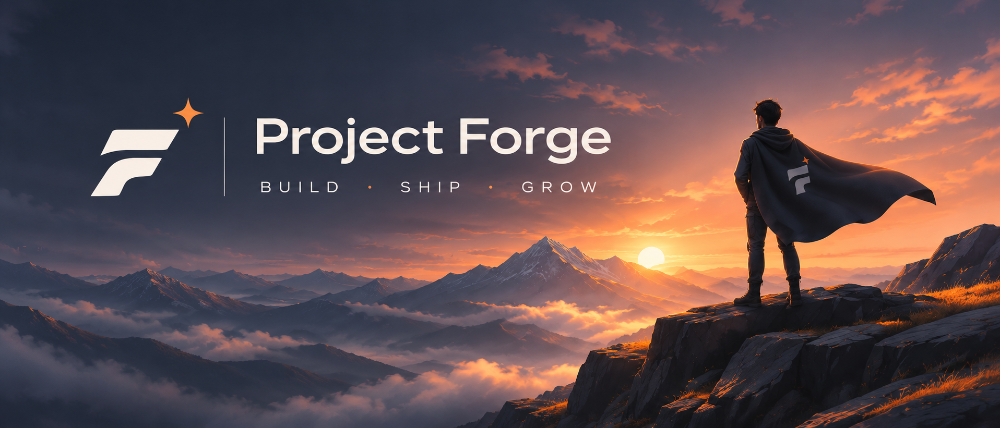

### Учимся разработке через совместные проекты

Сообщество для тех, кто хочет практиковаться, находить напарников и доводить идеи до работающего результата.

[Посмотреть проекты](https://github.com/orgs/Project-Forge-Team/repositories) · [Присоединиться](https://github.com/Project-Forge-Team/.github/issues/new?title=Хочу+присоединиться) · [Предложить идею](https://github.com/Project-Forge-Team/.github/issues/new?title=Идея+проекта)

---

## Что такое Project Forge

Мы собираем сообщество разработчиков, чтобы вместе создавать проекты для практики и портфолио. Здесь можно попробовать новую технологию, получить обратную связь по коду и научиться работать в команде.

Сообщество только формируется. Его направление и первые совместные проекты будем выбирать вместе с участниками.

## Кому будет интересно

- Начинающим, которым хочется применить знания в реальном проекте.
- Разработчикам с опытом, которые ищут напарников или хотят попробовать новый стек.
- Дизайнерам и тестировщикам, которым интересна совместная работа над продуктом.

Участие добровольное и без оплаты. Каждый выбирает задачи по интересу, опыту и доступному времени. Участие не предполагает трудоустройства или обещания будущего заработка.

## Что будем делать

Сайты, веб-приложения, Telegram-ботов, небольшие инструменты и другие проекты, предложенные участниками. Начинаем с небольшого объёма, который можно закончить и показать.

У каждого проекта — понятная цель, список задач и инструкция запуска. Готовый результат можно добавить в портфолио, честно указав свой вклад и соблюдая условия проекта.

## Как присоединиться

[Создай заявку в Issues](https://github.com/Project-Forge-Team/.github/issues/new?title=Хочу+присоединиться) и коротко расскажи:

- Что уже умеешь и чему хочешь научиться.
- Какие проекты или направления тебе интересны.
- Сколько времени примерно готов уделять практике.
- Есть ли примеры работ — это необязательно.

Заявки публичные: для знакомства достаточно GitHub-профиля, телефон и другие личные данные не нужны. После обсуждения подберём первую задачу и необходимые доступы.

Есть идея? [Предложи проект](https://github.com/Project-Forge-Team/.github/issues/new?title=Идея+проекта): какую задачу он решает, что войдёт в первую версию и какая помощь нужна.

## Как работаем вместе

1. **Договариваемся об объёме.** Перед началом выбираем небольшой результат и распределяем задачи.
2. **Обсуждаем изменения.** Работаем в отдельных ветках, отправляем pull request и помогаем друг другу на ревью.
3. **Уважаем время.** Если задача застряла или планы изменились, сообщаем команде. Просить помощи нормально.
4. **Разбираемся в своём коде.** ИИ можно использовать, но автор изменения должен уметь его объяснить и проверить.
5. **Общаемся спокойно.** Критикуем решения, уважительно относимся к людям, не высмеиваем ошибки и вопросы.
6. **Указываем авторство.** До начала работы согласуем публикацию, лицензию и использование проекта в портфолио. Чужие материалы используем с разрешения, ключи и личные данные не публикуем.

---

**Есть желание практиковаться? Начни со знакомства или небольшой идеи.**

